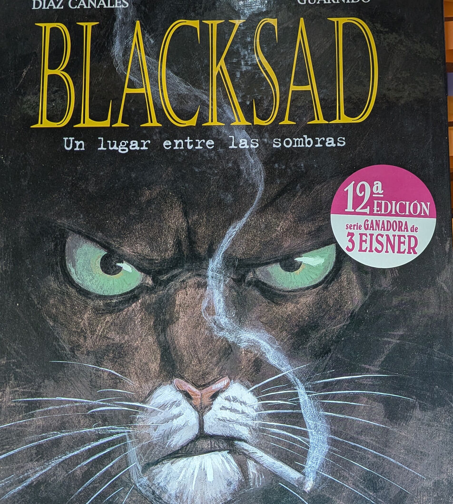

# Introducción

El *noir* es un género eminentemente urbano. No hay *noir* en la campiña inglesa, si acaso novela de crímenes al estilo de Agatha Christie; no puede existir el *noir* en los Apalaches, si acaso novela gótica. No existe el noir en las refulgentes playas de California, ni en la sabana africana: por eso hay que inventarse sub-géneros tales como el surf-noir [@curnutt2017catch] (más surf que noir) y el *bush noir* con Mma Ramotswe y su "Agencia de detectives para mujeres número 1" [@ramotswe].

En este trabajo examinaremos los 7 tomos de Blacksad [@DiazCanalesGuarnido2000Blacksad; @DiazCanalesGuarnido2003ArcticNation; @DiazCanalesGuarnido2005AlmaRoja; @DiazCanalesGuarnido2010InfiernoSilencio; @DiazCanalesGuarnido2013Amarillo; @DiazCanalesGuarnido2021TodoCaePrimeraParte; @DiazCanalesGuarnido2023TodoCaeSegundaParte] desde el punto de vista de la imagen de la ciudad americana que representan y cómo se aprovechan los recursos del cómic para crear atmósfera y dar el *sentido de lugar* habitual en el género.

## Dramatis personae y su relación con los autores

{#fig-blacksad  fig-pos="h!tbp" width=40%}

John Blacksad @fig-blacksad, un gato negro, es el protagonista de los siete albums de la serie. Aparece por primera vez en la segunda viñeta de "Un lugar entre las sombras" [@DiazCanalesGuarnido2000Blacksad], estableciendo las características básicas del personaje: es un gato de piel oscura, antropomorfizado hasta el punto de abandonar las pupilas lineales de los gatos por unas pupilas redondas con un iris marrón, y habitualmente ataviado con una gabardina. En esta segunda viñeta ya se establece el género claramente; en la primera página se completa este encuadre: mujer muerta, sexualizada, interacción del detective con la policía, caracterizada a su vez como un sabueso.

Díaz Canales y Guarnido, respectivamente guionista y dibujante de la serie, se conocieron en el estudio de animación Lápiz Azul en Madrid [@SantamariaAlonso2015], donde se dedicaban a diseñar los llamados *layouts*. La introducción del personaje en las 4 primeras viñetas de la serie, estrechando la segunda viñeta donde enfocamos los ojos del detective (*private eye*, en inglés), el ensanchamiento de la tercera viñeta donde se ve el cadáver (que indica que se abren los ojos en sorpresa) y la cuarta, donde estrechamos el foco desde la tercera y mostramos los dos personajes y la casa, demuestran la habilidad compartida en esta labor y la compenetración entre guión y dibujante [@Freeman2014Guarnido].

{#fig-weasel fig-pos="h!tbp" width=40%}

El siguiente personaje habitual es Weekly (a veces llamado simplemente week), una comadreja (*weekly* - *weasel*) que ejerce de periodista, y que ocupa el rol de *buddy* y contrapunto cómico a la extrema seriedad de Blacksad. Sus ojos grandes y papada blanca, así como su pelaje marrón dorado, contrastan con el de Blacksad. Aparece por primera en la 6ª viñeta de Arctic Nation [@DiazCanalesGuarnido2003ArcticNation], en la segunda página.

Guarnido estuvo trabajando como animador en los estudios Disney en Paris durante 10 años; de hecho, estuvo trabajando simultáneamente a las primeras ediciones del cómic. No solo esa idea de antropomorfizar animales viene de ahí, sino que incluso el dimorfismo sexual viene de esa escuela Disney [@RomeroBenguigui2023], donde además se usa el tipo de animal y sus atributos habituales (astucia del gato, el ser huidizo y la curiosidad de la comadreja) para describir de forma sencilla y directa un personaje.

La idea original del cómic, sin embargo, partió de Díaz Canales [@RomeroBenguigui2023], aunque involucró a Guarnido a mediados de los años 90; Guarnido estudió Bellas Artes en Granada y Díaz Canales es madrileño, pero se conocieron en Madrid en el ya mencionado estudio Lápiz Azul [@Freeman2014Guarnido].

## La ciudad como escenario en el cómic de Blacksad

{#fig-marcas-ciudad fig-pos="h!tbp" width=40%}

Como se ha indicado al principio, el *noir* se desarrolla en ciudades, no se puede entender sin las mismas, impartiendo un *sentido de lugar* que no es tan lejano a los relatos de viajes pero con un tinte psico-social que es específico de este tipo de novelas.

Hasta cierto punto, las novelas gráficas, especialmente en este género, se pueden entender como un recorrido psicogeográfico a través que sigue al protagonista y a la acción, pero que también sitúa al lector abriendo perspectivas o creando una serie de hitos dentro de la ciudad, usando la propia cuadrícula de la página como un *camino* en la que el lector se convierte, con los personajes y especialmente Blacksad, en un *flaneur* o paseante a la deriva por una ciudad que en el caso de Blacksad son reales y situadas en unos años 50 de América más o menos vagos.

Estas derivas se van acentuando según progresa la serie, como muestra este apilado de todos los cómics con marcas en donde aparecen paisajes urbanos @fig-marcas-ciudad, llegando a un pico en los últimos de la serie, "Todos Caen" [@DiazCanalesGuarnido2021TodoCaePrimeraParte; @DiazCanalesGuarnido2023TodoCaeSegundaParte], donde la ciudad es casi un protagonista y posiblemente la verdadera víctima. 

## Las ciudades americanas, su color y sus iconografía

## Historia de Nueva York en "Todo Cae"

## Conclusiones: ficción para el realismo

## Referencias

::: {#refs}
:::
