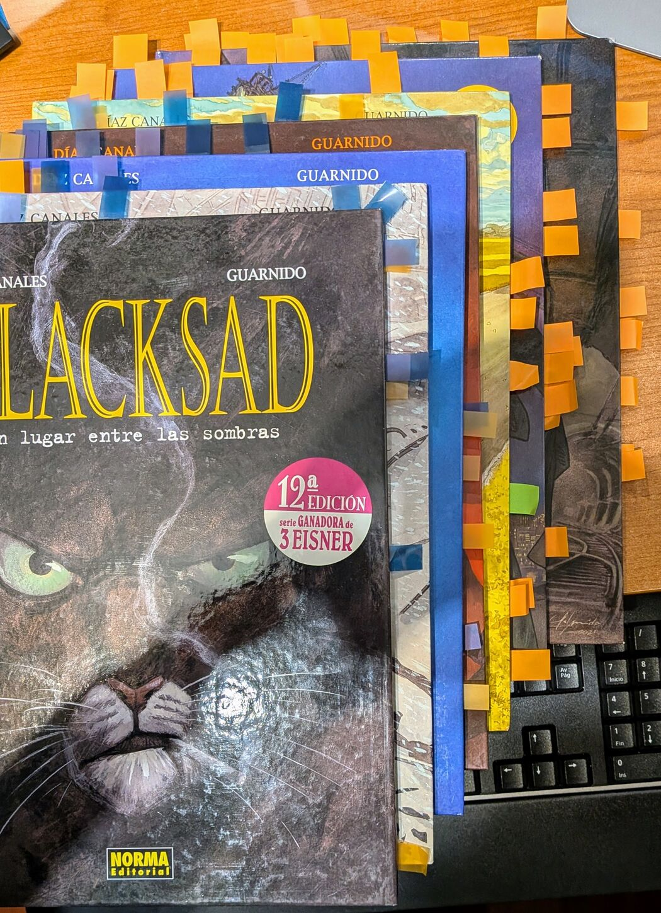
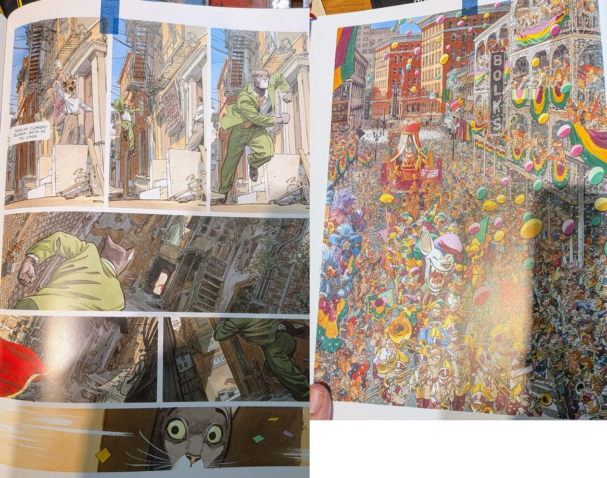
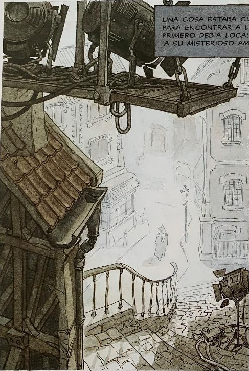
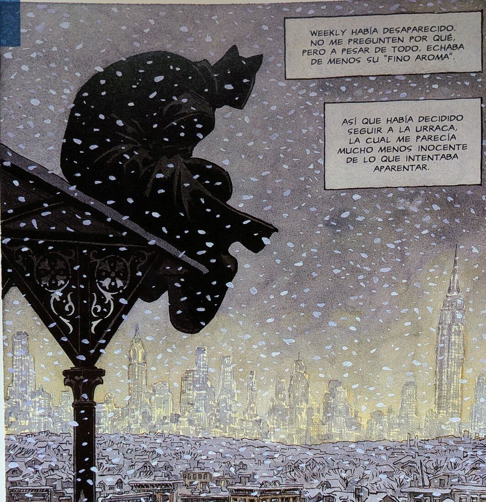
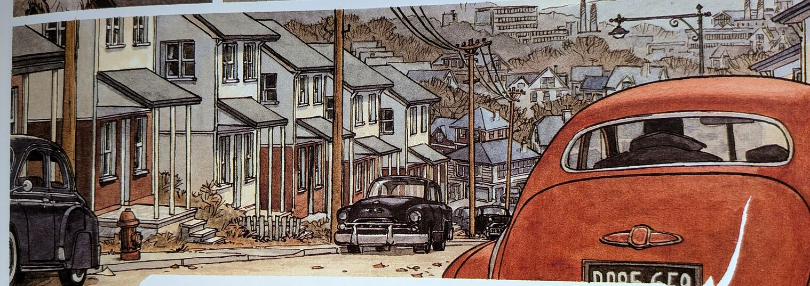
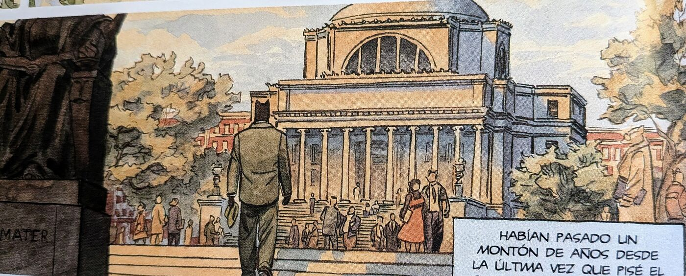
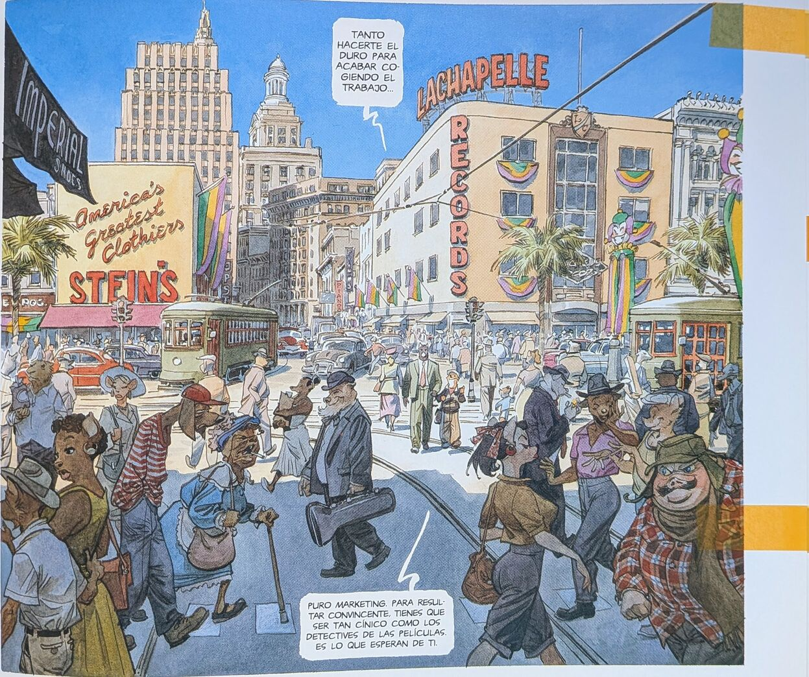
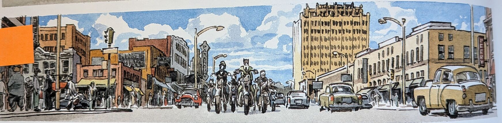
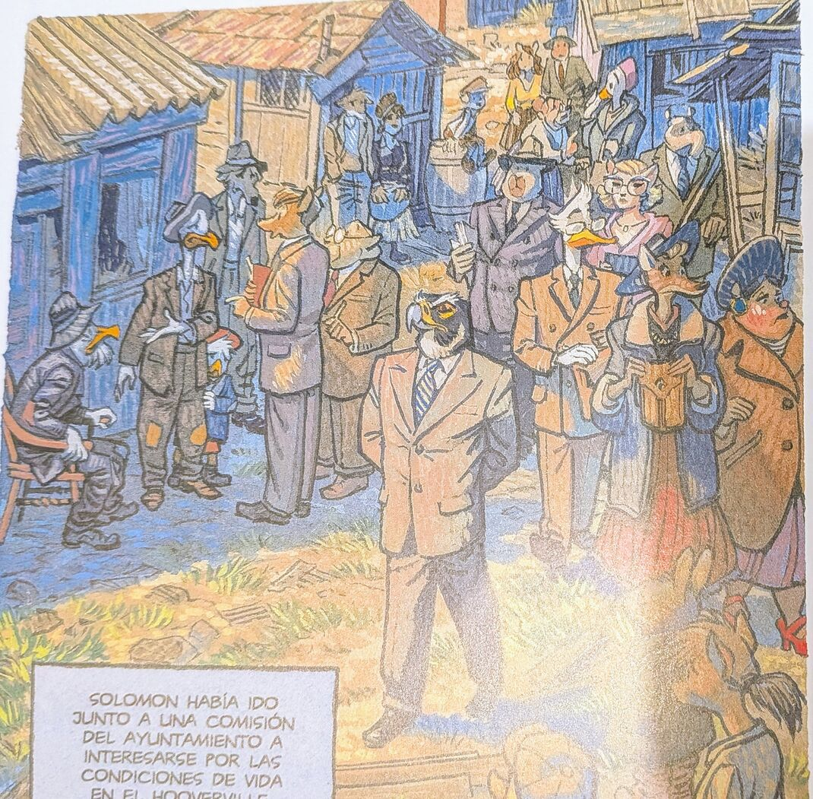
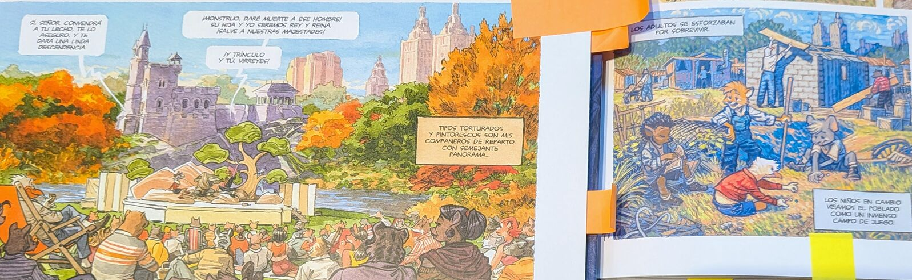

# Introducción

El *noir* es un género eminentemente urbano. No hay *noir* en la campiña inglesa, si acaso novela de crímenes al estilo de Agatha Christie; no puede existir el *noir* en los Apalaches, si acaso novela gótica. No existe el *noir* en las refulgentes playas de California, ni en la sabana africana: por eso hay que inventarse subgéneros tales como el *surf-noir* [@curnutt2017catch] (más *surf* que *noir*) y el *bush noir* con Mma Ramotswe y su "Agencia de detectives para mujeres número 1" [@ramotswe].

En este trabajo examinaremos los siete tomos de Blacksad [@DiazCanalesGuarnido2000Blacksad; @DiazCanalesGuarnido2003ArcticNation; @DiazCanalesGuarnido2005AlmaRoja; @DiazCanalesGuarnido2010InfiernoSilencio; @DiazCanalesGuarnido2013Amarillo; @DiazCanalesGuarnido2021TodoCaePrimeraParte; @DiazCanalesGuarnido2023TodoCaeSegundaParte] desde el punto de vista de la imagen de la ciudad americana que representan y cómo se aprovechan los recursos del cómic para crear atmósfera y dar el *sentido de lugar* habitual en el género.

## Dramatis personae y su relación con los autores

{#fig-blacksad  fig-pos="h!tbp" width=40%}

John Blacksad (@fig-blacksad), un gato negro, es el protagonista de los siete álbumes de la serie [@PintoTortosa20262]. Aparece por primera vez en la segunda viñeta de *Un lugar entre las sombras* [@DiazCanalesGuarnido2000Blacksad], estableciendo las características básicas del personaje: es un gato de piel oscura, antropomorfizado hasta el punto de abandonar las pupilas lineales de los gatos por unas pupilas redondas con un iris marrón, y habitualmente ataviado con una gabardina. En esta segunda viñeta ya se establece el género claramente; en la primera página se completa este encuadre: mujer muerta, sexualizada, interacción del detective con la policía, caracterizada a su vez como un sabueso.

Díaz Canales y Guarnido, respectivamente guionista y dibujante de la serie, se conocieron en el estudio de animación Lápiz Azul en Madrid [@SantamariaAlonso2015], donde se dedicaban a diseñar los llamados *layouts*. La introducción del personaje en las cuatro primeras viñetas de la serie, estrechando la segunda viñeta donde enfocamos los ojos del detective (*private eye*, en inglés), el ensanchamiento de la tercera viñeta donde se ve el cadáver (que indica que se abren los ojos en sorpresa) y la cuarta, donde estrechamos el foco desde la tercera y mostramos los dos personajes y la casa, demuestran la habilidad compartida en esta labor y la compenetración entre guionista y dibujante [@Freeman2014Guarnido; @Hochwender2023Translating].


{#fig-weasel fig-pos="h!tbp" width=40%}

El siguiente personaje habitual es Weekly (a veces llamado simplemente *Week*), una comadreja (*weekly* se parece a *weasel*) que ejerce de periodista, y que ocupa el rol de *buddy* y contrapunto cómico a la extrema seriedad de Blacksad. Sus ojos grandes y papada blanca, así como su pelaje marrón dorado, contrastan con el de Blacksad. Aparece por primera vez en la sexta viñeta de *Arctic Nation* [@DiazCanalesGuarnido2003ArcticNation], en la segunda página.

Guarnido estuvo trabajando como animador en los estudios Disney en París durante diez años, en parte simultáneamente a las primeras ediciones del cómic. No solo esa idea de antropomorfizar animales viene de ahí, sino que incluso el dimorfismo sexual viene de esa escuela Disney [@RomeroBenguigui2023], donde además se usa el tipo de animal y sus atributos habituales (astucia del gato, el ser huidizo y la curiosidad de la comadreja) para describir de forma sencilla y directa un personaje.

La idea original del cómic, sin embargo, partió de Díaz Canales [@RomeroBenguigui2023], aunque involucró a Guarnido a mediados de los años 90; Guarnido estudió Bellas Artes en Granada y Díaz Canales es madrileño, pero se conocieron en Madrid en el ya mencionado estudio Lápiz Azul [@Freeman2014Guarnido].

# La ciudad como escenario en el cómic de Blacksad


{#fig-marcas-ciudad fig-pos="h!tbp" width=60%}

Como se ha indicado al principio, el *noir* se desarrolla en ciudades, no se puede entender sin las mismas, impartiendo un *sentido de lugar* que no es tan lejano a los relatos de viajes pero con un tinte psico-social que es específico de este tipo de novelas.

Hasta cierto punto, las novelas gráficas, especialmente en este género, se pueden entender como un recorrido psicogeográfico [@Tso2020] a través de la ciudad que sigue al protagonista y a la acción, pero que también sitúa al lector abriendo perspectivas o creando una serie de hitos dentro de la ciudad, usando la propia cuadrícula de la página como un *camino* [@Davies2019] en el que el lector se convierte, con los personajes y especialmente Blacksad, en un *flâneur* o paseante [@Tolja2014] a la deriva por una ciudad que en el caso de Blacksad son, en muchos casos, reales y situadas en unos años 50 de América más o menos vagos.

{#fig-infierno width=100% fig-pos="h!tbp"}

Estas derivas se van acentuando según progresa la serie, como muestra este apilado de todos los cómics con marcas en donde aparecen paisajes urbanos (@fig-marcas-ciudad), llegando a un pico en los últimos de la serie, *Todo cae* [@DiazCanalesGuarnido2021TodoCaePrimeraParte; @DiazCanalesGuarnido2023TodoCaeSegundaParte], donde la ciudad es casi un protagonista y posiblemente la verdadera víctima.

Pero comienzan en los primeros episodios; por ejemplo en esta doble página (@fig-infierno) de *El infierno, el silencio* [@DiazCanalesGuarnido2010InfiernoSilencio] no solo recorremos con Blacksad los callejones más míseros de Nueva Orleans (véase la sección siguiente) sino que aprovecha el salto de página para golpear al lector con un hito psicogeográfico de la ciudad, los multitudinarios desfiles del carnaval que anuncia, de forma magistral, con los cuatro trozos de confeti cuyos colores se van a repetir en la siguiente *splash-page*. A la vez, Canales y Guarnido van *aplastando* la perspectiva para mostrar en la última viñeta estrecha el primerísimo plano de los ojos abiertos de Blacksad, ojos a los que seguimos para enfocar la siguiente página. Este recurso de cerrar la última viñeta de la página de la derecha y abrir la de la izquierda se usa también en las páginas 3-4 de *Arctic Nation* [@DiazCanalesGuarnido2003ArcticNation].

Como indica también @Davies2019, los cómics muestran la segregación en las ciudades del mundo actual. En la antepenúltima viñeta de la primera página hay un umbral estrecho con luz al otro lado que marca esta segregación: del caos estructural al orden urbano con un caos organizado de forma festiva.

Página que nos sirve también para ilustrar cómo se refleja la ciudad como escenario [@CityAsTheatre]. Las ciudades en el cómic no son reales, son escenarios creados por los autores y como tales pueden seguir las reglas de Serlio: [la *scena tragica*](https://archive.org/details/tutteloperedarch00serl/page/n139/mode/2up) tiene una perspectiva amplia, proporciones clásicas, claridad y clasicismo; la [*scena comica*](https://archive.org/details/tutteloperedarch00serl/page/n137/mode/2up) tienen recovecos, caos, portales, esquinas, y sobre todo muchas líneas quebradas que cierran la perspectiva. Díaz Canales y Guarnido usan repetidamente este tipo de recurso, pero en esta doble página se puede ver el tipo de escenario "cómico" en la primera página y el "trágico" en la segunda, donde la bandera americana ocupa el punto de fuga en la perspectiva. En Blacksad se usa la *scena comica* para las persecuciones caóticas, las máscaras; las *scene tragiche* son, sin embargo, escenarios solemnes donde la ciudad se convierte en protagonista. En dobles páginas o secuencias como la @fig-infierno, además, se usan como contraste social para mostrar la miseria y la sordidez al lado de la fiesta y el orden implícito en las celebraciones oficiales; ese contraste social y psicogeográfico se ve acentuado por el uso del color; en la última viñeta de la primera página las piezas de confeti de color amarillo, morado y verde contrastan con los colores fríos y oscuros que dominan la página que se convierten en colores primarios, vivos, cálidos cuando pasamos página.

En algunos casos el cómic se convierte en metaficción con referencias a otras obras de arte visuales, en muchos casos contextualmente adecuadas, es decir, referenciando otras obras que suceden en el mismo lugar, o relacionadas de alguna forma temática con la obra. En otros casos, simplemente, se trata de homenajes, como veremos más adelante.

# Las ciudades americanas, su color y sus iconografías en el "ciclo de los colores"


En la ficción se suelen usar una serie de tropos visuales para identificar las ciudades de las que se trata; tanto en el cine como en los cómics, los autores usan esos tropos para que el lector sepa identificar esas ciudades y asignarles los atributos correspondientes, que pasan a formar parte del contexto en el que sucede la acción. A estos tropos se les añade el ambiente *noir* que les da un tono y una atmósfera determinada, pero siempre tratando de hacer las ciudades reconocibles. A continuación trataremos de ver, para los cinco primeros tomos, de qué ciudad se trata y cómo usan los autores la iconografía tradicional para introducirla.

En todo caso, los autores han tratado siempre de componer *la ciudad* como trasfondo y a veces personaje de la acción; una ciudad que puede tomar elementos visuales de una ciudad real americana y por tanto se puede interpretar posiblemente como esa ciudad, pero que no deja de ser una ciudad ficticia e irreal. Por esa razón, casi siempre presentará tropos visuales de diferentes ciudades que harán cualquier identificación solamente tentativa.

## Un lugar entre las sombras

{#fig-decorado width=50% fig-pos="h!tbp"}

Es muy complicado, o directamente imposible, saber dónde se sitúa la acción de este episodio de la serie. La falta de tropos visuales impide situarla exactamente en algún lugar.

```{=latex}
\begin{wrapfigure}{r}{0.4\textwidth}
  \centering
  \includegraphics[width=0.4\textwidth,height=0.7\textheight,keepaspectratio]{img/statoc-tower-small.jpg}
  \caption{Blacksad dirigiéndose hacia la Statoc Tower}
  \label{fig-statoc}
\end{wrapfigure}
```

La mansión que se muestra en la primera viñeta y el hecho de que se trate de una actriz, apunta a Los Ángeles. Hay también una escena [p. 16, @DiazCanalesGuarnido2000Blacksad] (@fig-decorado) que se desarrolla en un estudio cinematográfico en una escena, que, por cierto, recuerda a la fotografía ["Hyères" de Cartier-Bresson](https://www.centrepompidou.fr/fr/ressources/oeuvre/cL9RgbG) tratando de decir quizá que el decorado imitaba a una calle parisina.

Sin embargo, el resto de las escenas y sobre todo la imagen final, de una calle genérica de una gran ciudad con casas altas y mansiones con una pequeña escalera delante (típicas de las zonas más señoriales de Manhattan y Brooklyn) la colocan en una "gran ciudad americana genérica", como afirma @SantamariaAlonso2015. Yo tiendo a no estar de acuerdo; de hecho, la calle final podría corresponder a la zona de *downtown* Los Angeles. Además, en esa escena aparece un cartel de un comercio o bar llamado "Hammet's", una referencia a Dashiell Hammett lo que apuntaría a la costa oeste, ya que Hammett usa San Francisco como escenario para algunos de sus relatos.

La psicogeografía aparece en escenas como la Figura \ref{fig-statoc}: Blacksad se empequeñece ante la Statoc Tower, clara muestra del poder del constructor, el sapo Statoc. Los autores muestran las diferentes escalas de la ciudad, creando casi un *axis mundi* que conecta la tierra con el cielo de las estrellas; en este caso, las de cine ya que Statoc parece ser un trasunto de [Adolph Zukor](https://en.wikipedia.org/wiki/Adolph_Zukor) [@PintoTortosa20262], el magnate de la industria cinematográfica. Por otro lado, la torre, aunque inspirada en edificios reales (como la torre RCA), no corresponde a ningún hito real, dejando a la ciudad de este tomo en la indefinición.

En todo caso, lo cierto es que lo que tratan de transmitir los autores es una ciudad *noir* por antonomasia, que toma referentes de diferentes grandes ciudades americanas quizás con el objetivo de colocarla en un universo propio y original. Con este primer número se inicia el llamado "Ciclo del color" que abarca los cinco primeros álbumes. En este caso el color que prevalece sería el negro (que técnicamente no es un color, sino ausencia del mismo).

## Arctic Nation

El segundo álbum [@DiazCanalesGuarnido2003ArcticNation]^[El videojuego basado en el cómic, *Blacksad: Under the Skin*, se sitúa entre este tomo y el anterior [@ClavijoCorchero2024; @FernandezRuizGarciaReyes2021].] del ciclo del color, tiene como color principal el blanco. En un contexto de racismo sistémico [@ClavijoCorchero2024] y apoyado por la policía, se presenta como una lucha racial de los animales con piel o pelambre blanca (osos polares, armiños) contra todos los demás.

Eso fuerza la identificación de la ciudad con una del sur de Estados Unidos contradiciendo las afirmaciones en la literatura [@SantamariaAlonso2015; @PintoTortosa20262] que la identifican como Nueva York con la única base de la viñeta final donde aparece un edificio que podría parecerse al Empire State Building. Sin embargo, se ve en la propia viñeta a unos coches descendiendo una cuesta al final de la cual está ese edificio, un paisaje que no aparece en Nueva York, donde no hay prácticamente ninguna colina rodeando la isla de Manhattan.

{#fig-batsad width=70% fig-pos="h!tbp"}

Hay otros factores que contradicen esta identificación que se encuentra en la literatura. Primero, por la actitud de racismo institucionalizado dentro de la misma policía, se trata de una ciudad en un estado del sur. La ciudad donde se desarrolla la acción está caracterizada por una serie de elementos visuales:

- Primero y más importante, porque define el episodio, es la nieve.
- El barrio "The Line", un barrio segregado, es otro elemento característico.
- Aparece de forma bastante prominente un viaducto elevado para un tren o tranvía.
- En esa línea elevada hay estaciones abandonadas, que sirven para una referencia intertextual a Batman y su Gotham City (@fig-batsad).
- Tiene un papel fundamental en la trama una fábrica de aviación abandonada, donde aparece un bombardero semidesguazado que parece un [Boeing B-17 Flying Fortress](https://es.wikipedia.org/wiki/Boeing_B-17_Flying_Fortress) o en todo caso un bombardero pesado. La iglesia que aparece en la página 26, con una torre central y de estilo llamado federal o *colonial revival*, también puede encontrarse en la costa este estadounidense y especialmente en Maryland en suburbios como Annapolis, aunque es más frecuente que estén hechas en ladrillo y no en madera como esta.

{#fig-rowhouses width=80% fig-pos="h!tbp"}

Hay varias ciudades que cumplen todas esas condiciones, entre ellas Memphis, Tennessee y Baltimore, Maryland. Pero hay un detalle adicional: en una viñeta en la página 44 aparece una estación de servicio de la marca (ficticia) East Coast Gasoline. Esto situaría a la ciudad definitivamente en la costa este, como Baltimore.

Baltimore tiene también un relieve considerable, con colinas de hasta 140 metros, lo que explicaría las cuestas que aparecen frecuentemente en el álbum (por ejemplo, en la misma página 44 y en la última página a la que hemos aludido).

La @fig-rowhouses muestra el urbanismo característico de un suburbio donde habitan los "malos" de *Arctic Nation*, casas idénticas, unifamiliares, estrechas y escalonadas a lo largo de una cuesta, con planta baja de ladrillo y porche delantero; al fondo, en la colina, casas aisladas de madera (*clapboard houses*) en una calle recta en el tipo de urbanismo que se denomina [*streetcar suburb*](https://en.wikipedia.org/wiki/Streetcar_suburb).

Este tipo de urbanismo no se puede contrastar con el de "The Line", el suburbio segregado que es parte importante en la trama; apenas hay unas pinceladas como una plaza y un restaurante, "Barry's diner". En estos episodios tempranos, Díaz Canales y Guarnido todavía no habían entrado en el modo "urbanismo-ficción" que usarían más adelante.

De forma relativamente excepcional, la historia continúa en las guardas del final del volumen. En un paisaje desértico en el que pone "Las Vegas 11 ml", se adivina el urbanismo en retícula de esta ciudad a la que llega una larga y recta carretera. La misma escena aparece en la guarda de la portada del siguiente volumen, estableciendo así un puente entre los mismos.

## Alma roja

{#fig-low width=80% fig-pos="h!tbp"}

Siguiendo la escena de la guarda de la portada que repite la de la contraportada del volumen anterior, las primeras páginas transcurren en Las Vegas, principalmente en interiores, aunque en la segunda viñeta de la página 5 usa contrastes entre el dorado brillante de Las Vegas con el gris de un callejón para mostrar esta división psicogeográfica de la ciudad, la frontera entre lo visible y lo invisible.

Este álbum [@DiazCanalesGuarnido2005AlmaRoja], dominado claramente por el color rojo en todos los sentidos, el de la amenaza nuclear y el *red scare* de los años 50 en Estados Unidos, le da más importancia a la arquitectura que al urbanismo. La escena de la página 6 donde aparece la detonación de una bomba atómica desde lo que parece la terraza de un casino hace referencia a las [*dawn bomb parties*](https://www.lvcva.com/press/75th-anniversary/atomic/), o "fiestas de la bomba al amanecer": la gente se reunía para contemplar las pruebas nucleares en el "Sitio de Pruebas de Nevada", una zona de pruebas del ejército americano. Sin embargo, la imagen de la ciudad que aparece es genérica, con fragmentos de carteles que hacen referencia a Las Vegas, pero sin una rejilla o hitos reconocibles.

Otro detalle permite situar una parte del álbum en Nueva York: la presencia de la [Low Memorial Library de la universidad de Columbia](https://en.wikipedia.org/wiki/Low_Memorial_Library) (@fig-low); también una escena en Central Park en la página 53 mostrando el [Bow Bridge](https://en.wikipedia.org/wiki/Bow_Bridge_(Central_Park)). Las escenas callejeras (por ejemplo, p. 31 donde también aparece *downtown*) son compatibles con la ciudad de Nueva York sin dejar de referirse a esa ciudad genérica propia del universo Blacksad.

Esta localización también permite situar a las calles dilapidadas, llenas de vagabundos y de basura, por las que Otto Liebber vaga en la página 31, en la misma ciudad; la tipología de las casas e incluso de la iglesia abandonada (p. 32) son compatibles con las que hay en esa ciudad. Díaz Canales y Guarnido usan recursos habituales para mostrar un barrio de extracción baja: ropas tendidas de balcón a balcón, ladronzuelos perseguidos por policías con porra, y las escaleras de escape metálicas que también suelen usarse iconográficamente para referirnos a esa ciudad.

En la página 55, en tonos de gris y como resolución de la trama, aparece una ciudad alemana por la que pasea Liebber (el científico atómico) y plantea un enigma. @PintoTortosa20262 solo menciona que Liebber va a un lugar desconocido; sin embargo el hecho de que Blacksad reciba una carta en el presente demuestra que Liebber le está escribiendo desde el lugar que se muestra. Y lo que se muestra es una ciudad alemana, lo que se ve con el cartel que anuncia "Hauptstrasse", destruida casi en su totalidad pero en reconstrucción. Dado que nos hallamos en los años 50 y que las ciudades de Alemania Occidental estaban prácticamente reconstruidas a principios de los 50, eso podría indicar que se trata de una ciudad de la zona de Alemania ocupada por los soviéticos como Dresde, Leipzig o simplemente una pequeña ciudad donde Otto Liebber parece haber encontrado empleo como profesor de primaria a la vez que ayuda en la reconstrucción.

En este número empieza a haber referencias al mundo cultural y artístico contemporáneo americano, con una escena de una galería de arte llamada "Hopper" y un artista trasunto de Rothko, llamado Litvak; estas son algunas de las referencias culturales de este volumen, aunque hay muchas más: a Severo Ochoa (Otero) y Allen Ginsberg (un bisonte). La música tiene un papel importante a partir de este episodio: en el piso de Weekly suena "That Old Black Magic" [@oldblackmagic] de Ella Fitzgerald. También hay una referencia a Maus con Hitler como un gato en una foto [@SantamariaAlonso2015].

## El infierno, el silencio

{#fig-ignatius width=90% fig-pos="h!tbp"}

En este cuarto volumen que es exteriormente azul, pero que en realidad es el volumen multicolor del ciclo del color [@DiazCanalesGuarnido2010InfiernoSilencio] no es complicado asignarle Nueva Orleans, como ya se ha visto en la @fig-infierno. También aparece explícitamente en la página 5 en un llamado "Nueva Orleans Jazz'n'Fun". Para documentarse, aparte de usar fotografías históricas de referencia, hicieron un viaje sobre el terreno [@Freeman2014Guarnido]. Blacksad, como *flâneur*, nos ofrece una visión del *genius loci* o verdadera esencia urbana de la ciudad [@Tso2020] (@fig-infierno), mostrando el genio del lugar, un *sentido del lugar* que como se ha referido en la introducción, es la esencia del *noir*.

Díaz Canales y Guarnido tratan con especial cariño este volumen de la saga, incluyendo referencias tanto reales como imaginarias. @fig-ignatius incluye no solo una perspectiva real de un cruce de calles en Nueva Orleans con unos almacenes, Stein's, perfectamente reconocibles, aparte de los dos edificios del fondo, el [National American Bank Building](https://en.wikipedia.org/wiki/National_American_Bank_Building) y el [Hibernia Bank Building](https://en.wikipedia.org/wiki/Hibernia_Bank_Building_(New_Orleans)), los dos del *Business District* de Nueva Orleans, sino también un personaje ficticio de la novela *La conjura de los necios*, Ignatius J. Reilly, que se desarrolla en Nueva Orleans.

Esta no es la única referencia: en la página 15 una escena en un tranvía hace referencia a *Un tranvía llamado deseo*, que sucede en Nueva Orleans también. @SantamariaAlonso2015 afirma que la @fig-ignatius muestra tal línea, sin nada que lo apoye ni ninguna marca visual en la imagen que lo haga. Sin embargo, el hecho es que la línea "Desire" pasaba precisamente por este punto que se ha identificado, así que es una referencia, un tanto rebuscada, a la misma obra.

Los tranvías aparecen repetidamente y con el modelo y librea adecuado, reflejando la importancia del mismo en el urbanismo de Nueva Orleans, que creció siguiendo las líneas del tranvía a mediados del siglo XX. La anchura de las calles, que se ve por ejemplo en la última viñeta de la página 11, en las figuras ya referidas o en la página 55, se diseñó teniendo el tranvía en cuenta, incluyendo el bulevar central que aparece en la página 11 (última viñeta).

La ciudad de Nueva Orleans también está caracterizada por la proximidad del Mississippi, el río que le da la vida y, cuando se desborda, se la quita. La ciudad vista desde el río, con un característico vapor de palas, aparece en la página 28, con una escena completa en tal vapor llamado ["SS President", un barco real recreado con fidelidad](https://en.wikipedia.org/wiki/President_(1924_steamboat)). También hay una escena en la página 36 que continúa en la 41.

En esa misma página 41 aparece a medio construir el [Greater New Orleans Bridge](https://en.wikipedia.org/wiki/Crescent_City_Connection) [@SantamariaAlonso2015], que cruza el río Mississippi, lo que permite datar el cómic como anterior al año 1958, cuando se inauguró. Este puente, que conectaba las dos orillas del río, supuso un cambio urbanístico radical en la ciudad, provocando una fiebre inmobiliaria en la ciudad y la creación de suburbios a unos minutos del centro histórico a través de ese puente.

Este puente a medio construir es ya una prefiguración de *Todo cae*, los dos últimos tomos de la serie. Pero además, fue un [proyecto de la firma de ingeniería de Robert Moses llamada "Andrews and Clark" en 1946](https://search.library.northwestern.edu/nde/fulldisplay/alma9982804876102441/01NWU_INST:NUTL_NDE). Es bastante improbable que los autores tuvieran ya en mente al menos el germen de la idea de esos últimos, pero lo cierto es que muestra su preocupación por la transformación epocal del urbanismo de las ciudades americanas en los años 50.

## Amarillo

{#fig-amarillo width=100% fig-pos="h!tbp"}

No hace falta decir cuál es el color de este último tomo de la saga de los colores [@DiazCanalesGuarnido2013Amarillo]; se refiere en realidad a una ciudad de Texas, pero el color en un tono u otro inunda el álbum: Blacksad transita en un Cadillac Eldorado de color amarillo por las carreteras doradas del desierto al amanecer (página 8); el circo se llama Girasol y tiene una carpa de color amarillo; las flores marchitas en las últimas páginas también lo son.

En este tomo, sin embargo, no se trata tanto de una ciudad como de una carretera, la Ruta 66, que va de Chicago a Los Angeles pasando, claro, por Amarillo, Texas. El tránsito entre diferentes partes de Estados Unidos parece ser el tema principal: Union Station en Chicago y Grand Central en Nueva York, estación Greyhound, escenas del ferrocarril entre unas partes y otras del mismo.

Tránsito masivo que, como la Ruta 66, da lugar a un tipo de ciudad muy específico, como la Amarillo que se muestra en la página 20, claramente reconocible también por el [Santa Fe Building](https://en.wikipedia.org/wiki/Santa_Fe_Building_(Amarillo,_Texas)). Y es que también Amarillo es una encrucijada entre la carretera y el ferrocarril, añadiendo al tema del álbum, que también hace referencias a *En la carretera* de Jack Kerouac, cuyo avatar en el mismo es Chad Lowell.

Tránsito que creó en muchas ciudades el modelo de *main street*, una calle alargada a lo largo de una ruta terrestre, carretera o ferroviaria. Se trata del llamado *urbanismo lineal* o *street village*. En Amarillo la calle principal era la calle Polk, mostrada en la @fig-amarillo. En la psicogeografía de este tipo de ciudades, un ritual llamado [*dragging main*](https://pioneergirlproject.org/2021/05/21/dragging-main/) (*draggin' Polk*, en el caso de Amarillo) consistía en ir en coches descapotables paseando por la calle, torciendo al llegar al final. En la figura, el gang de moteros que ha incluido a Blacksad está haciendo exactamente eso.

El cómic muestra también otras ciudades en la Ruta 66, a veces indicadas explícitamente:

- En la escena de Tulsa, Oklahoma (p. 9) aparece un cartel "Route US 66" y la *main street* indicada, que en este caso sí parece coincidir con tal ruta.
- Albuquerque, Nuevo México, también en la ruta, aparece solo en un cartel indicando dónde sucede la acción.
- Santa Fe, Nuevo México, aparece etiquetada pero también uno de sus hitos, la iglesia de San Miguel.
- Raton, Nuevo México: una casa con porche residencial con *picket fences* en una calle alineada con postes eléctricos o telegráficos, típico de un suburbio de una ciudad pequeña ligada al ferrocarril como lo es [Raton](https://en.wikipedia.org/wiki/Raton,_New_Mexico), prácticamente creada por la Atchison, Topeka and Santa Fe Railway (cuyas oficinas se ven en @fig-amarillo) para servir como hito a la entrada del Raton Pass (dibujado también de forma realista en la página 45 del volumen, atravesado por un tren de tal compañía en el que va el circo).
- De Chicago, fin de la Ruta 66, vemos hacia el final del volumen la Union Station, primero en perspectiva aérea y luego a nivel de calle; también la chata "Greyhound station", mostrando, como se ha dicho, los dos modos de transporte principales.
- Finalmente, el Empire State Building y el Chrysler Building nos devuelven a Nueva York, con una vista del East River al fondo.

La estación de Greyhound de Chicago vuelve a aparecer en la última viñeta, completando el recorrido psicogeográfico de la Ruta 66 en sentido inverso.

# Historia de Nueva York en *Todo cae*

{#fig-solomon-hooverville width=60% fig-pos="h!tbp"}

En esta historia, dividida en dos volúmenes [@DiazCanalesGuarnido2021TodoCaePrimeraParte; @DiazCanalesGuarnido2023TodoCaeSegundaParte;@Hochwender2023BlacksadReview], es donde Díaz Canales y Guarnido se acercan más a la historia del urbanismo, el de Nueva York en los años 50 y sucesivos, cuando [Robert Moses](https://en.wikipedia.org/wiki/Robert_Moses), bajo el inocuo título de director de la Triborough Bridge Authority así como otros títulos como presidente de la comisión del parque estatal de Long Island, rehizo el urbanismo de la ciudad suprimiendo barrios enteros y segregando a base de vías infranqueables barrios de gente de color de otros para ingresos más altos.

En los dos tomos se recorre prácticamente toda la historia. Como se muestra en la @fig-solomon-hooverville, el trasunto de Moses, llamado Lewis Solomon (cambiando una figura bíblica por otra), aparece en las *hoovervilles* con la intención de eliminarlas y crear sobre ellas un parque, en una de las raíces de la trama. El *leit motiv* del *noir* es atajar las injusticias infligidas sobre alguien o algo. En este caso, la propia ciudad de Nueva York, convertida en *teriópolis* o ciudad de animales, es la que sufre estas injusticias. Los continuos viajes a las entrañas de Nueva York parece que sirva de trasunto de las entrañas metafóricas de la ciudad como organismo, y cómo a base de esos ataques y los cadáveres que aloja, la enfermedad acaba afectando a toda la ciudad. La injusticia social es un cáncer, y Blacksad trata de diagnosticarlo y, ya que no puede curarlo, al menos evitar su progreso.

{#fig-paralelo width=100% fig-pos="h!tbp"}

En @fig-paralelo, que aparece en el segundo tomo, los autores crean un hito psicogeográfico, uniendo la infancia sana y feliz de uno de los protagonistas al poblado en el que vivían, una *hooverville*. Las mismas torres que aparecen como fondo de la función teatral en el parque en el primer tomo. Así los autores transmiten el derribo de la colonia y la construcción, en el mismo lugar, del parque. Esto sucedió en los años 30, igual que en la serie: en lo que hoy es el *Great Lawn* se creó la llamada *Depression street*, una calle de construcciones improvisadas, algunas de ellas con bastante solidez. Robert Moses, como comisionado de parques, fue el que impulsó el desalojo. Aunque no es la posición que se refleja en la imagen, el fondo de la primera corresponde de forma precisa a [esta foto](https://avccxlqtlq.cloudimg.io/https://citydays.com/blog-assets/media/images/The_Best_Castles_to_visit_in_New_Y.2e16d0ba.fill-450x450_PUFpgZv.jpg), sacada desde Central Park. En primer término el Belvedere Castle, y las torres que se repiten son los [San Remo Apartments](https://es.wikipedia.org/wiki/The_San_Remo), que actúan así como ancla de la historia urbanística y también anclaje a la ciudad real. A la vez la imagen aparece en la página 33 como un cuadro en la casa de uno de los protagonistas, pintado por él, precisamente el niño-gaviota que aparece abajo a la derecha. El eje que une la historia personal con la historia urbanística y social se estructura de esta forma a través del hito psicogeográfico mostrado en las tres imágenes.

Los dos ejes de la lucha de Moses/Solomon, contra el transporte público y las minorías, se vertebran en esta novela precisamente a través del padre de este niño, Shelby, que, convertido en matón de Solomon, es el ariete contra los sindicatos del metro a la vez que lo hace por su hijo. El espacio en el que se encuentra el teatro también actúa como tal eje: en él se encuentra el cadáver del presidente del sindicato (página 1 del tomo II). En esta geografía de la ciudad que se traslada al *layout* del cómic, la viñeta en la que se encuentra el cadáver se encuentra en la misma posición que la viñeta de la @fig-paralelo en el tomo I; una vez más, usando el concepto de hito psicogeográfico, el castillo Belvedere aparece en la viñeta 1 de ese tomo, anclando el lugar.

Como se ha dicho, el *noir* da un sentido de lugar; usando todos los recursos al alcance del cómic, Díaz Canales y Guarnido usan la geografía física y del cómic para crear un relato que es a la vez una psicogeografía de la ciudad de Nueva York.

Este capítulo también incluye referencias que lo encuadran totalmente dentro del género *noir*: la más importante es la que liga un halcón que representa a Horus en el despacho de Blacksad a Solomon, que aparece en esa misma imagen (viñetas finales de la página 14, tomo I); a su vez, hace referencia a *El halcón maltés*, una de las obras más importantes de Dashiell Hammett y un hito del género.

Una referencia adicional, otra, a Hopper es la viñeta en la página 38 del tomo I, donde se *teriomorfiza* el "Nighthawks" de Hopper y se integra en la narración de Iris Allen de su vida en los años 30, convirtiendo al barman en un cerdo y a los otros parroquianos en una imagen vaga del animal. La imagen del mismo bar se actualiza al presente desde el que se está narrando y no se parece en nada, aunque la imagen siguiente al cuadro presenta al barman con el cuadro detrás, contrastando lo que fue y lo que es en ese momento.

# Conclusiones: ficción para la historia del urbanismo

De unos inicios en los cuales la ciudad es trasfondo y metáfora, la serie de Blacksad se va convirtiendo, poco a poco, en una crónica de las transformaciones en el transporte y el tránsito de masas y sus consecuencias urbanísticas narradas como una historia social y hasta cierto punto cultural de los Estados Unidos de los años 50: *Arctic Nation* habla de la segregación y del abandono de los barrios segregados; *Alma roja* incide más en la historia cultural, aunque también tiene una incursión en la reconstrucción de la Europa de la posguerra; *El infierno, el silencio* muestra una Nueva Orleans creada alrededor de los tranvías y apunta a su transformación usando puentes; *Amarillo* es la crónica del urbanismo de las carreteras federales y el ferrocarril de costa a costa; finalmente, *Todo cae* es la historia de la lucha de Robert Moses y el automóvil contra la ciudad.

En resumen, una forma interesante de entender la historia del urbanismo en los Estados Unidos de la mano de dos maestros del cómic con un proceso de planificación e investigación a un nivel muy elevado, que les ha llevado a conseguir premios internacionales como el Eisner.

# Nota sobre las imágenes

Todas las imágenes son (c) Díaz Canales y Guarnido. Se invoca el derecho de cita para incluirlas en este documento. No han sido modificadas ni retocadas salvo en el color y encuadre.

# Referencias

::: {#refs}
:::
