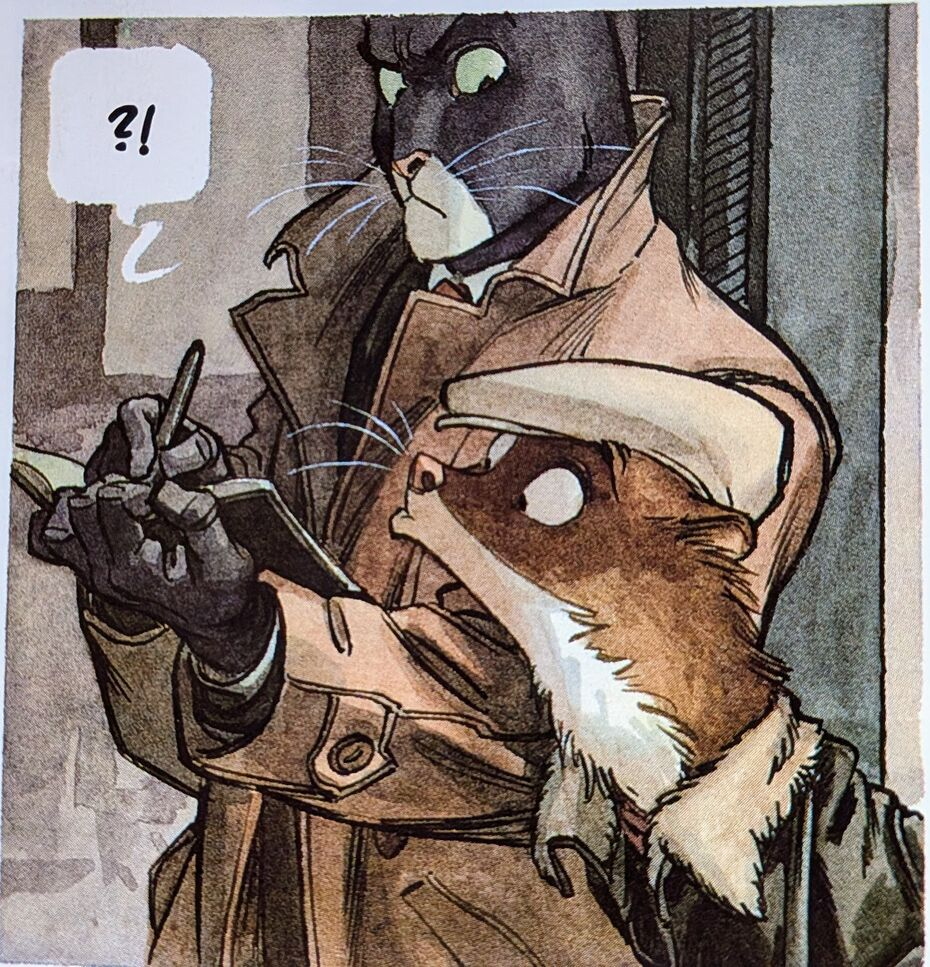

# Introducción

El *noir* es un género eminentemente urbano. No hay *noir* en la campiña inglesa, si acaso novela de crímenes al estilo de Agatha Christie; no puede existir el *noir* en los Apalaches, si acaso novela gótica. No existe el noir en las refulgentes playas de California, ni en la sabana africana: por eso hay que inventarse sub-géneros tales como el surf-noir [@curnutt2017catch] (más surf que noir) y el *bush noir* con Mma Ramotswe y su "Agencia de detectives para mujeres número 1" [@ramotswe].

En este trabajo examinaremos los 7 tomos de Blacksad [@DiazCanalesGuarnido2000Blacksad; @DiazCanalesGuarnido2003ArcticNation; @DiazCanalesGuarnido2005AlmaRoja; @DiazCanalesGuarnido2010InfiernoSilencio; @DiazCanalesGuarnido2013Amarillo; @DiazCanalesGuarnido2021TodoCaePrimeraParte; @DiazCanalesGuarnido2023TodoCaeSegundaParte] desde el punto de vista de la imagen de la ciudad americana que representan y cómo se aprovechan los recursos del cómic para crear atmósfera y dar el *sentido de lugar* habitual en el género.

## Dramatis personae y su relación con los autores

{#fig-blacksad height=400px}

John Blacksad @fig-blacksad, un gato negro, es el protagonista de los siete albums de la serie. Aparece por primera vez en la segunda viñeta de "Un lugar entre las sombras" [@DiazCanalesGuarnido2000Blacksad], estableciendo las características básicas del personaje: es un gato de piel oscura, antropomorfizado hasta el punto de abandonar las pupilas lineales de los gatos por unas pupilas redondas con un iris marrón, y habitualmente ataviado con una gabardina. En esta segunda viñeta ya se establece el género claramente; en la primera página se completa este encuadre: mujer muerta, sexualizada, interacción del detective con la policía, caracterizada a su vez como un sabueso.

Díaz Canales y Guarnido, respectivamente guionista y dibujante de la serie, se conocieron en el estudio de animación Lápiz Azul en Madrid [@SantamariaAlonso2015,]

{fig-weasel height=400px}
El siguiente personaje habitual es Weekly (a veces llamado simplemente week), una comadreja (*weekly* - *weasel*) que ejerce de periodista, y que ocupa el rol de *buddy* y contrapunto cómico a la extrema seriedad de Blacksad. Sus ojos grandes y papada blanca, así como su pelaje marrón dorado, contrastan con el de Blacksad.

## La ciudad como escenario en el cómic de Blacksad

## Las ciudades americanas, su color y sus iconografía

## Historia de Nueva York en "Todo Cae"

## Conclusiones: ficción para el realismo

## Referencias

::: {#refs}
:::
